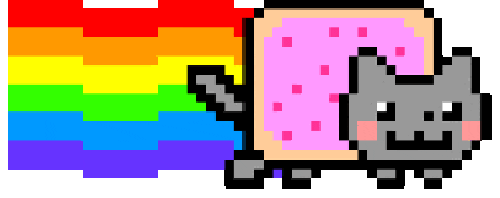

<div align="center">

  <!-- Retro Terminal Mascot -->
  <a href="https://andrixlab.me">
    
  </a>

  <br/><br/>

  # Andri Dwi Somantri
  ### ✦ Cleon Thadeas ✦

  <p align="center">
    <b>Mobile & Backend Developer • Full Stack Engineer • Product Builder</b>
  </p>

  <!-- Dynamic Typing Animation -->
  <a href="https://github.com/CleonThadeas">
    
  </a>

  <br/><br/>

  <!-- Interactive Badges -->
  <a href="https://andrixlab.me">
    
  </a>
  &nbsp;
  <a href="https://www.linkedin.com/in/andridwisomantri/">
    
  </a>
  &nbsp;
  <a href="https://github.com/CleonThadeas">
    
  </a>
  &nbsp;
  <a href="https://andrixlab.me#contact">
    
  </a>

  <br/><br/>

  

</div>

<br/>

---

### 👨‍💻 Developer Profile

```yaml
identity:
  name: "Andri Dwi Somantri"
  alias: "Cleon Thadeas"
  brand: "AndrixLab"
  location: "Bandung, Indonesia"

specialization:
  mobile: "Flutter & Dart (Cross-Platform Architecture)"
  backend: "Laravel (PHP) & Golang (RESTful APIs & Services)"
  frontend: "Nuxt.js, Vue.js, Tailwind CSS"
  data: "PostgreSQL, MySQL, Firebase"

status:
  focus: "Architecting reliable mobile apps & scalable web systems"
  learning: "Distributed Systems, Microservices, and AI Integration"
```

---

### 🛠️ Tech Stack & Arsenal

<div align="center">

  

  <br/><br/>

| Category | Technologies & Tools |
| :--- | :--- |
| **Mobile Engineering** |    |
| **Backend & APIs** |     |
| **Frontend & Web** |     |
| **Databases** |    |
| **DevOps & Tools** |     |

</div>

---

### 📊 GitHub Activity & Analytics

<div align="center">

  
  &nbsp;&nbsp;
  

  <br/><br/>

  

</div>

---

<div align="center">

  <!-- Energetic Nyan Cat Divider -->
  

  <br/><br/>

  > *"Do your best so the results will follow. Don't give up."*

  <br/>

  ```text
  B U I L D   ✦   L E A R N   ✦   I M P R O V E   ✦   R E P E A T
  ```

</div>
