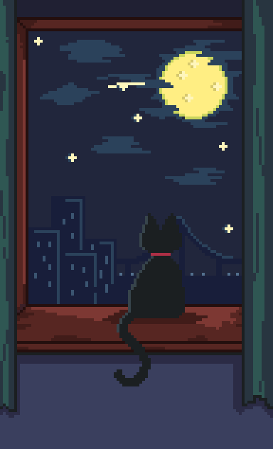

  <!-- Mascot / Header Animation -->
  

    

  # Andri Dwi Somantri
  ### 📱 Mobile & Backend Developer ⚙️

  <!-- Dynamic Typing Subtitle -->
  

    

  <!-- Social & Quick Links -->
  
  &nbsp;
  
  &nbsp;
  
  &nbsp;
  

 

---

### 👨‍💻 About Me

Software developer specializing in **cross-platform mobile applications** and **backend engineering**. Focused on building reliable software with clean architecture, robust APIs, and practical business impact.

- 📱 **Mobile Development**: Crafting responsive, fluid mobile applications using **Flutter & Dart**.
- ⚙️ **Backend & APIs**: Architecting scalable RESTful APIs and backend services with **Laravel (PHP)** and **Golang**.
- 🌐 **Modern Web**: Building modern frontend interfaces with **Nuxt.js / Vue.js** and **Tailwind CSS**.
- 🗄️ **Databases & DevOps**: Relational database design in **PostgreSQL** & **MySQL**, containerized with **Docker** on **Linux**.

---

### 🛠️ Tech Stack

---

### 🚀 Featured Projects

| Project | Description | Stack |
| :--- | :--- | :--- |
| **[ImamKu](https://andrixlab.me/project/imamku-smart-mosque-scheduling-management-system)** | Smart mosque scheduling & prayer notification system with automated broadcast workflows | `Flutter` `Laravel` `PostgreSQL` |
| **[OkGreen](https://andrixlab.me/project/okgreen-circular-economy-waste-management-platform)** | Circular economy platform for digital waste exchange, reward points, and eco-education | `Flutter` `Laravel` `MySQL` |
| **[TripleA Inventory](https://andrixlab.me/project/tripleainventory-it-asset-management-system)** | Enterprise IT asset management system with multi-tier approval flows & audit logging | `Laravel` `MySQL` `Tailwind CSS` |
| **[AndrixLab](https://andrixlab.me)** | Personal developer portfolio & interactive hub built with modern web practices | `Nuxt.js` `Tailwind CSS` `GSAP` |

---

### 📊 GitHub Activity

  
  &nbsp;&nbsp;
  

---

   

  > *"Do your best so the results will follow."*

  Build. Learn. Improve. Repeat.

